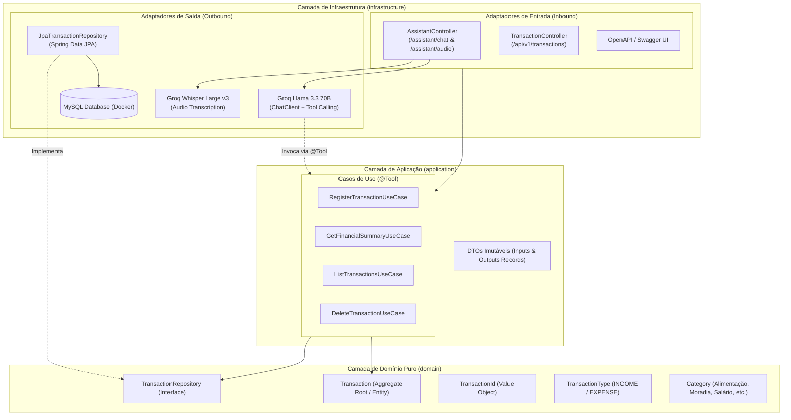

# Especificação Técnica do Projeto (Project Spec)
## Assistente Financeiro Inteligente com Spring AI & Clean Architecture / DDD

---

## 1. Visão Geral do Produto e Objetivos

O projeto é uma **API de Gestão Financeira Inteligente** desenvolvida com **Java 25**, **Spring Boot 4** e **Spring AI**. A aplicação permite que usuários registrem receitas e despesas, consultem balanços e gerenciem transações através de comandos de **voz** (áudio real) ou **texto** (chat interativo), orquestrado por um modelo de Linguagem com **Tool Calling** (execução de funções reais de negócio).

### 🎯 Diretrizes Principais
* **Custo Zero (100% Gratuito):** Sem perfis de simulação/mock. Integração real com a infraestrutura gratuita de alta velocidade da **Groq** via protocolo OpenAI (Whisper Large v3 para áudio + Llama 3.3 70B para Tool Calling).
* **Rigor Arquitetural:** Fidelidade absoluta aos princípios de **DDD (Domain-Driven Design)** e **Clean Architecture**, mantendo o domínio puro e isolado de frameworks.
* **Critérios da DIO:** Documentação clara, concisa e focada nos 5 pontos avaliados no desafio.

---

## 2. Design e Arquitetura

### 2.1. Diagrama de Arquitetura em Camadas (Clean Architecture)



---

### 2.2. Design do Domínio (DDD)

* **Entidade Raiz (`Transaction`):**
  * `TransactionId id`: Identificador forte (UUID).
  * `String description`: Descrição clara e não vazia.
  * `BigDecimal amount`: Valor estritamente maior que zero.
  * `TransactionType type`: `INCOME` (Receita) ou `EXPENSE` (Despesa).
  * `Category category`: Categoria consistente com o tipo.
  * `Instant createdAt`: Registro temporal da transação.
  * **Regras de Invariante:** Validação encapsulada dentro do construtor de domínio (falha imediatamente se violada com `DomainException`).

* **Value Objects e Enums:**
  * `TransactionId`: Record imutável tipado.
  * `TransactionType`: `INCOME`, `EXPENSE`.
  * `Category`:
    * *Receitas:* `SALARIO`, `INVESTIMENTOS`, `FREELANCE`, `OUTRAS_RECEITAS`.
    * *Despesas:* `ALIMENTACAO`, `MORADIA`, `TRANSPORTE`, `SAUDE`, `EDUCACAO`, `LAZER`, `OUTRAS_DESPESAS`.

* **Repositório de Domínio (`TransactionRepository`):**
  * Interface pura com métodos de negócio: `save`, `findById`, `findAll`, `findByCategory`, `findByType`, `deleteById`.

---

### 2.3. Design da IA e Tool Calling (Spring AI + Groq)

* **Provedor:** `https://api.groq.com/openai/v1` via chave gratuita da Groq (`GROQ_API_KEY`).
* **Transcrição de Áudio (STT):** `whisper-large-v3` processa gravações em português com alta precisão e sem custo.
* **Orquestração e Raciocínio (LLM):** `llama-3.3-70b-versatile` com parâmetros:
  * `temperature: 0.1` (determinístico para tomada de decisão financeira).
  * `system-message.st`: Prompt de sistema instruindo a atuar como um CFO / assistente financeiro pessoal, mapear categorias e executar as ferramentas adequadas.
* **Memória de Conversação:** `ChatMemory` com `MessageChatMemoryAdvisor` para manter contexto de múltiplos turnos com base em `conversationId`.

---

## 3. Backlog de Tarefas e Planejamento de Sprints

### 🏃 Sprint 1: Fundação, Domínio DDD & Configurações Base
* [ ] **T1.1:** Inicializar configuração do Gradle com Spring Boot 4, Java 25 e dependências (Spring AI, Web, Data JPA, MySQL, Lombok, SpringDoc Swagger, Validation).
* [ ] **T1.2:** Configurar container do MySQL 9 via `compose.yml` com healthcheck.
* [ ] **T1.3:** Implementar o modelo de domínio puro:
  * Enums `TransactionType` e `Category`.
  * Value Object `TransactionId`.
  * Entidade `Transaction` com invariantes de negócio.
  * Interface `TransactionRepository`.
* [ ] **T1.4:** Criar testes unitários para o modelo de domínio (`TransactionTest`).

---

### 🏃 Sprint 2: Camada de Aplicação & Ferramentas (@Tool) da IA
* [ ] **T2.1:** Implementar DTOs de entrada e saída (records: `RegisterTransactionInput`, `TransactionOutput`, `FinancialSummaryOutput`).
* [ ] **T2.2:** Implementar `RegisterTransactionUseCase` anotado com `@Tool`.
* [ ] **T2.3:** Implementar `GetFinancialSummaryUseCase` anotado com `@Tool` (cálculo de total de receitas, despesas, saldo líquido e distribuição percentual por categoria).
* [ ] **T2.4:** Implementar `ListTransactionsUseCase` anotado com `@Tool` (filtros opcionais).
* [ ] **T2.5:** Implementar `DeleteTransactionUseCase` anotado com `@Tool` (estornos).
* [ ] **T2.6:** Criar testes unitários isolados dos casos de uso.

---

### 🏃 Sprint 3: Infraestrutura, JPA & Integração com Groq (Sem Mocks)
* [ ] **T3.1:** Implementar entidade JPA `TransactionEntity` e conversor bidirecional de/para o domínio.
* [ ] **T3.2:** Implementar `JpaTransactionRepository` adaptando a interface de domínio ao Spring Data.
* [ ] **T3.3:** Configurar `application.properties` apontando para o endpoint OpenAI-compatible da Groq:
  * `spring.ai.openai.base-url=https://api.groq.com/openai/v1`
  * `spring.ai.openai.api-key=${GROQ_API_KEY}`
  * `spring.ai.openai.chat.options.model=llama-3.3-70b-versatile`
  * `spring.ai.openai.audio.transcription.options.model=whisper-large-v3`
* [ ] **T3.4:** Criar prompt de sistema especializado em `src/main/resources/prompts/system-message.st`.
* [ ] **T3.5:** Configurar bean do `ChatClient` com registro das 4 ferramentas e suporte a `ChatMemory`.

---

### 🏃 Sprint 4: Controladores HTTP, Áudio & Swagger UI
* [ ] **T4.1:** Implementar `TransactionController` (CRUD REST convencional para `POST /api/v1/transactions`, `GET /api/v1/transactions`, etc.).
* [ ] **T4.2:** Implementar `AssistantController`:
  * `POST /api/v1/assistant/chat`: Requisição de texto com histórico e resposta estruturada.
  * `POST /api/v1/assistant/audio`: Upload multipart de áudio, transcrição via Whisper e execução de ferramentas.
* [ ] **T4.3:** Implementar `GlobalExceptionHandler` com `ProblemDetail` (RFC 7807) para tratamento elegante de erros.
* [ ] **T4.4:** Configurar OpenAPI 3 / Swagger (`OpenApiConfig`) para teste visual completo no navegador.
* [ ] **T4.5:** Copiar os 6 áudios de gravação de teste para `src/test/resources/audio/` e remover o diretório temporário `temp_repo`.

---

### 🏃 Sprint 5: Validação, Testes & Documentação Oficial DIO
* [ ] **T5.1:** Executar build completo (`./gradlew clean build`) e rodar testes automatizados.
* [ ] **T5.2:** Testar fluxos ponta a ponta com áudio real e chat via Swagger.
* [ ] **T5.3:** Redigir o `README.md` final com foco estrito nas exigências da DIO.

---

## 4. Requisitos Obrigatórios do README.md (Padrão DIO)

O `README.md` da raiz do repositório será estruturado para atender com clareza aos 5 pontos requeridos na avaliação:

```markdown
# 💰 Smart Budgeting API - Assistente Financeiro com Spring AI & Clean Architecture

## 1. O que o projeto faz
Breve explicação do fluxo inteligente: como a aplicação processa comandos de voz e texto, 
transforma linguagem natural em ações no banco de dados através de Tool Calling e devolve 
análises financeiras consolidadas (receitas, despesas, balanço e estornos).

## 2. Tecnologias Utilizadas
- Java 25 & Spring Boot 4
- Spring AI 2.0.0-M4 (ChatClient, Whisper STT, Tool Calling)
- Groq Cloud API (Whisper Large v3 e Llama 3.3 70B - 100% Gratuito)
- Spring Data JPA & MySQL 9 (Docker Compose)
- SpringDoc OpenAPI / Swagger UI (Interface interativa)
- JUnit 5 & Mockito (Testes automatizados)

## 3. Melhorias Implementadas em Relação ao Projeto Base
- **Suporte a Receitas e Despesas:** Diferente da versão base (apenas gastos), agora suporta controle de fluxo de caixa completo.
- **Novas Ferramentas de IA (@Tool):** Cálculo de balanço financeiro líquido e estorno de lançamentos.
- **Memória de Conversação (ChatMemory):** O assistente mantém o contexto de perguntas consecutivas.
- **Canal Híbrido (Texto + Voz):** Endpoint de chat REST direto sem depender exclusivamente de microfone.
- **Integração Real e Gratuita com Groq:** Execução rápida com IA de ponta sem custos de API.
- **Documentação Swagger Interativa:** Teste de todos os endpoints diretamente no navegador.

## 4. Como Executar a Aplicação
Instruções passo a passo:
1. Clonar o repositório
2. Obter chave gratuita na Groq (link direto)
3. Configurar variável de ambiente: `export GROQ_API_KEY="gsk_..."`
4. Subir o banco de dados: `docker compose up -d`
5. Iniciar a aplicação: `./gradlew bootRun`

## 5. Como Testar o Fluxo Principal
- Acessar o Swagger UI em `http://localhost:8080/swagger-ui.html`.
- Exemplos de requisições com `curl` (registro de despesa por texto e consulta de balanço).
- Teste de áudio utilizando os arquivos reais disponibilizados em `src/test/resources/audio/`.
```
